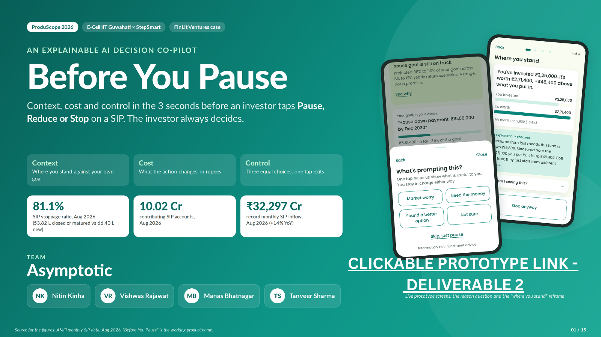
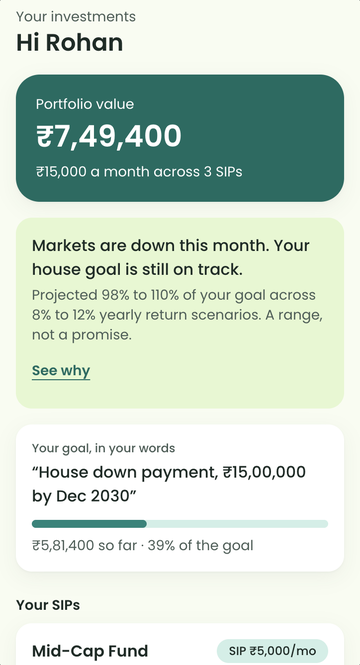
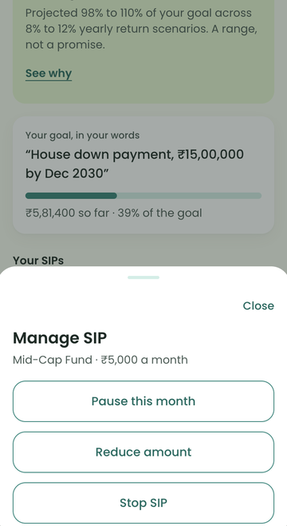
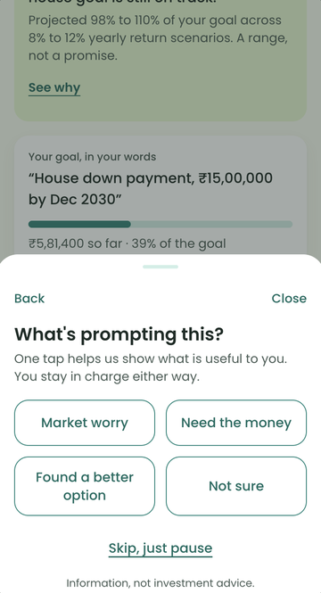
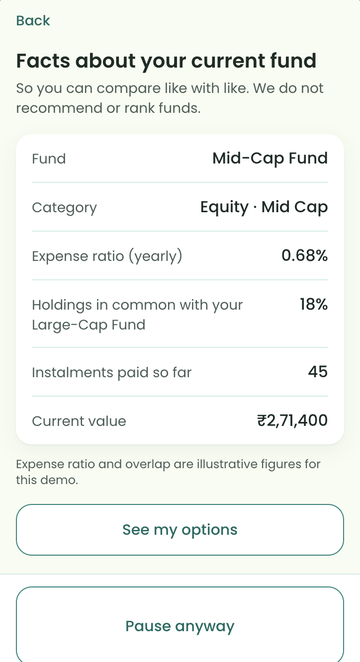
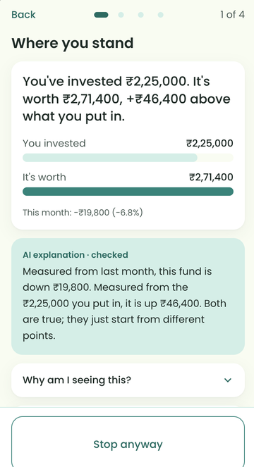
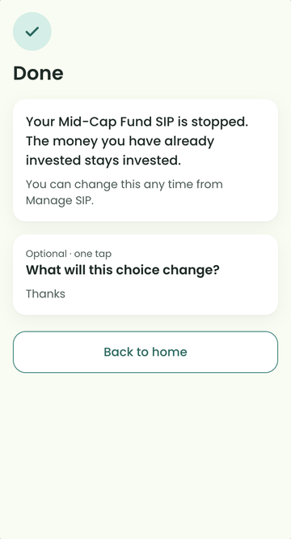

# Before You Pause

**An explainable AI co-pilot for the 3 seconds before an investor taps Pause, Reduce or Stop on a SIP.**

🥈 **2nd place, Grand Finale — ProduScope 2026** (E-Cell IIT Guwahati × StepSmart, FinLit Ventures case) · Team **Asymptotic**



---

## The problem

Investment apps explain *last month* very well, but say nothing at the moment a costly decision is made.

- In August 2026, India had **10.02 crore** contributing SIP accounts and a record **₹32,297 crore** of monthly SIP inflow, yet **53.82 lakh SIPs closed or matured against 66.40 lakh new ones** (a stoppage ratio of 81.1%; AMFI). In March and April 2026, more SIPs ended than started.
- Fear drives the tap: a loss weighs about **2.25×** an equal gain (Tversky & Kahneman, 1992), and a red monthly number becomes the reference point.
- The cost of pausing is invisible. Skipping 3 instalments of ₹5,000 (₹15,000) is worth about **₹22,137** by a goal date 51 months away at an assumed 10% a year.

The ProduScope brief asked for an AI financial co-pilot that intervenes at **one clearly defined decision moment** and keeps the investor in control. We chose **SIP Pause / Reduce / Stop**.

## The solution

When an investor taps Pause, Reduce or Stop, a short bottom sheet makes three promises:

| Promise | What the investor sees |
| --- | --- |
| **Context** | Where they stand against *their own* goal, not just last month: "down ₹19,800 this month, but still ₹46,400 above what you put in" |
| **Cost** | What the action changes, in rupees, under three labelled return scenarios (8 / 10 / 12%), plus how far the goal date moves |
| **Control** | Three equal-weight choices (skip one month, reduce for a while, pause) and a one-tap exit on every screen. Nothing changes until they confirm |

### How it works

1. **Tap** — the event `sip_action_selected` is the only trigger. Nothing fires on the dashboard or on headlines.
2. **Eligibility gate** — kill switch on, not a planned pause, no session in the last 14 days, consent given, at least 2 instalments, fresh nightly data, treatment arm. Any failure means the normal flow runs.
3. **One question** — "What's prompting this?" (market worry / need the money / found a better option / not sure), with "Skip, just pause" one tap away.
4. **Context by reason** — "need the money" gets a neutral cash path with no loss framing; "market worry" gets the reframe, cost card and Confidence Score; "found a better option" gets facts, never fund picks.
5. **Three equal choices**, then a plain confirmation, an optional one-tap recall question and a 90-day check-in.

**Fail open for the investor, fail closed for the AI:** if anything is slow or broken, the investor simply pauses as usual; if AI text is late, wrong or sounds like advice, a pre-approved template is shown instead.

### The AI rule: the engine calculates, the AI only explains

| Job | Who does it |
| --- | --- |
| Compute every number | A deterministic Python engine, run nightly after NAVs publish |
| Phrase the numbers in plain language | A small LLM that writes `{{placeholders}}` only; it never types a digit, recommends or predicts |
| Check every sentence | A validator: slot-fill, numeric grounding, and a banned-phrase lint in English and Hindi ("you should", "guaranteed", "will recover"…) |

### Prototype

| Home | Trigger | Reason | Facts, not picks | Where you stand | Confirmation |
| --- | --- | --- | --- | --- | --- |
|  |  |  |  |  |  |

### Measuring success

- **North Star: Comprehended Decision Rate (CDR) ≥ 55%** — attempts with ≥ 4 s on ≥ 2 context panels *and* a correct recall answer. We measure understanding, not retention: an informed pause counts as a win.
- **Outcome checks:** avoidance lift of +8 pp vs a holdout group, with regret no higher than holdout. If retention rises while regret rises too, we stop.
- **Pilot:** 50,000 FinLit accounts, randomised 50/50; 546 attempts per arm detect +8 pp, with the first readout near month 5.

## What's in this repo

```
deck/
  Before_You_Pause_Team_Asymptotic.pdf   the final 15-slide deck
  slides/slide-01.png … slide-15.png      each slide as an image
engine/
  engine.py        deterministic calculations: cost of skipping, goal projection, Confidence Score, recovery history
  validator.py     caption validator: slot-fill, numeric grounding, English + Hindi language lint
  api.py           FastAPI service skeleton (storage and partner adapters are stubs)
  test_appx.py     tests that reproduce the deck's numbers
db/
  schema.sql       Supabase / Postgres schema with row-level security and a hash-chained audit log
  kpi.sql          CDR, avoidance lift, regret, skip and fallback-rate queries
web/
  bff.ts           Next.js route handler that fails open if the engine is slow (800 ms)
  analytics.ts     consent-gated PostHog setup
docs/images/       README images
```

## Run the tests

```bash
cd engine
pip install -r ../requirements.txt
python -m pytest -q        # or: python test_appx.py
```

The tests check that the engine reproduces the deck's figures (₹22,137 / ₹20,539 / ₹23,827; corpus ₹14,67,853; Confidence Score 81, band "hold") and that the validator blocks advice, invented numbers, unknown slots and Hindi banned words.

## Status and honest caveats

- `engine.py`, `validator.py` and the tests run and pass. `api.py`, the SQL and the TypeScript files are a design spec: they compile or parse, but have not been run against a live Supabase or Next.js project.
- Personas, portfolios and prototype figures are illustrative sample data. All targets are pilot hypotheses, and the sizing assumptions are the team's own.
- This is decision support, not investment advice. Running it for real would need a licensed partner (RIA, distributor or AMC) and a legal review of the advice perimeter.

## Team Asymptotic

- Nitin Kinha
- Vishwas Rajawat
- Manas Bhatnagar
- Tanveer Sharma

Built for ProduScope 2026, organised by E-Cell IIT Guwahati with StepSmart, on a problem statement from FinLit Ventures.
